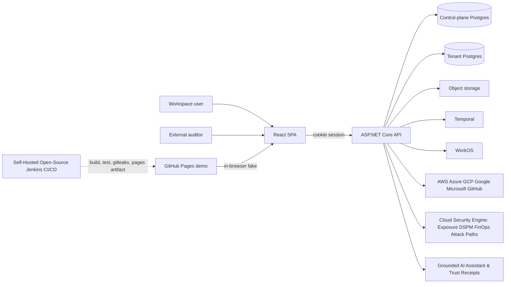
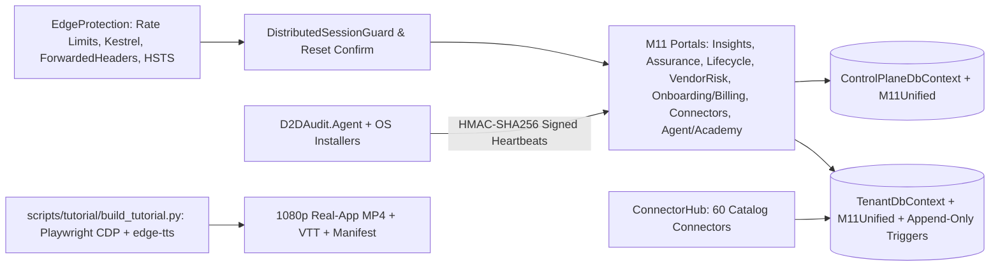
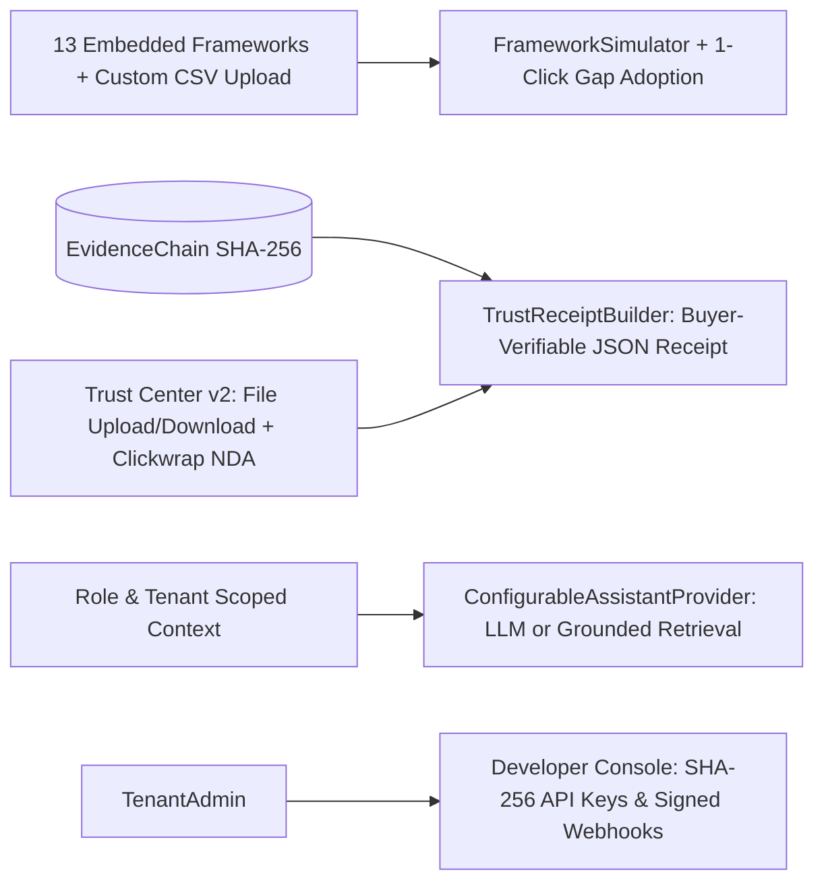
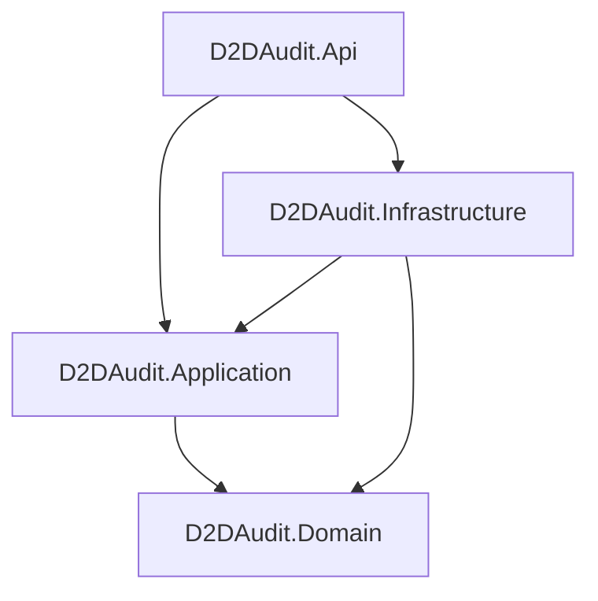
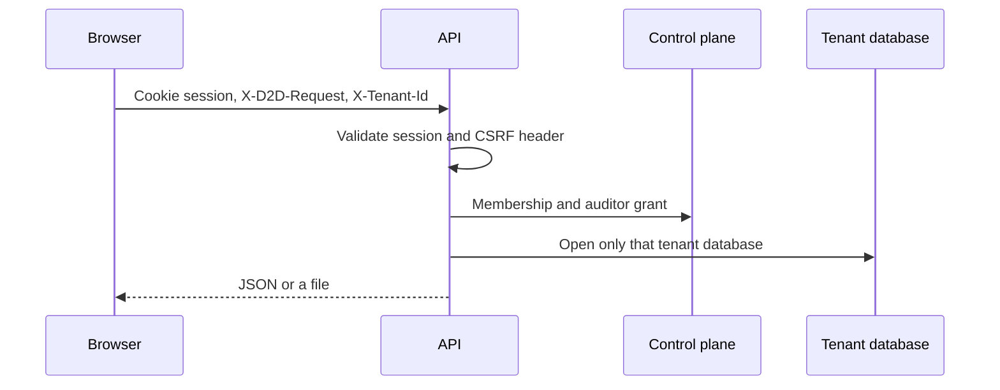

# Architecture

D2D Audit Services is a modular monolith. One API serves every tenant. Each tenant's business data lives in its own PostgreSQL database. The React app is the only UI. A public GitHub Pages build runs that same UI against an in-browser fake of the API.

## System context



## Milestone 11 Unified Platform Architecture (11 Integrated Workstreams)



- **Edge & Session Security (`EdgeProtection`, `ISessionGuard` / `DistributedSessionGuard`)**: Layered global + named rate limiting (`auth`, `public_trust`, `public_assistant`, `assistant`, `export`, `signup`), single-hop reverse proxy `ForwardedHeaders`, Kestrel slowloris/body limits, production safety assertions, HSTS, distributed login lockout, access-token revocation on logout, and refresh-token reuse detection.
- **Database Architecture Hardening (`DatabaseSettings`, `DbText`, `HardeningSql`, `M11DatabaseHardening`)**: PostgreSQL `d2d_append_only()` triggers on `evidence_chain` and `activity_events`, `EnableRetryOnFailure`, bounded per-tenant Npgsql pools, `xmin` optimistic concurrency on `tenants`/`risks`/`findings` (409 mapping), `jsonb` resource snapshots, `RESTRICT` on `evidence_items -> controls`, exact case-insensitive email matching, and LIKE wildcard escaping.
- **Insights, Notifications, Search & Reports (`IInsights`, `INotificationCenter`, `IGlobalSearch`, `IReports`, `InsightsDailyJob`)**: Daily posture snapshots (`posture_snapshots`), idempotent role-scoped notifications with SignalR push (`user_notifications`, `notification_receipts`, `notification_preferences`), global Cmd/Ctrl+K search, scheduled CSV/PDF executive reports (`report_schedules`), and password reset confirmation (`POST /api/v1/auth/reset`).
- **Custom Tests, Evidence Library & Policy Assurance (`ICustomTestPortal`, `IEvidenceLibraryPortal`, `IControlInsightPortal`, `IPolicyInsightPortal`)**: No-code condition builder (`custom_test_definitions`), test snooze/disable (`test_suppressions`), expiring multi-control evidence library & collection requests (`evidence_documents`, `evidence_document_links`, `evidence_requests`), control readiness profiles & versioned comments (`control_profiles`, `control_comments`, `control_comment_revisions`), and policy version diffs + attestation campaigns (`policy_attestation_campaigns`, `policy_attestations`).
- **Employee Lifecycle & Vendor Risk (`ILifecycle`, `IAccessRevoker`, `IVendorRisk`, `IVendorPortal`, `IVendorDiscoverySource`)**: Group-based onboarding/offboarding checklists with SLA tracking and automated access revocation (`employee_groups`, `lifecycle_checklists`, `lifecycle_steps`), plus vendor discovery, tiering, tokenized public vendor questionnaire portal (`/vendor-portal/:token`), and document review sign-off.
- **Self-Serve Onboarding, Billing, Invites & Risk Insights (`ISignupService`, `IOnboarding`, `IBilling`, `IFeatureGate`, `ITeamAccess`, `IRiskInsights`)**: Self-serve signup & email verification (`/signup`, `/signup/verify`), guided onboarding wizard (`/onboarding`), Stripe-ready billing & plan feature gating (`/settings/billing`), team invite links & SCIM/SSO security settings (`/invite/accept`), and risk heatmaps & acceptance workflows.
- **60-Connector Integration Marketplace (`IConnectorRegistry`, `IConnectorHub`, `src/seed/connectors.json`)**: 45 new live/fixture connectors plus 15 built-in integrations across 13 categories with encrypted credential storage, connection testing, sync run history (`integration_sync_runs`), and 16 additional automated compliance checks.
- **Cross-Platform Device Agent & Security Academy (`IDeviceAgent`, `IAcademy`, `src/agent/D2DAudit.Agent/`, `agent/windows/`, `agent/unix/`)**: Standalone `.NET` device posture agent + Windows PowerShell (`install.ps1`) and macOS/Linux (`install.sh`, `launchd`, `systemd`) installers authenticating via short-lived enrollment tokens and HMAC-SHA256 signed heartbeats, paired with a 7-course interactive Security Academy with quizzes, PDF certificates, and HR-06 evidence.
- **Unified EF Core Schema (`20261122004719_M11Unified`, `20261122004744_M11Unified`)**: Single clean unified M11 migration pair covering all 6 new control-plane tables and 31 new tenant tables with zero pending model changes (`SchemaParityTests`), synchronized OpenAPI snapshot (`src/web/openapi/v1.json`), and generated TypeScript schema (`src/web/src/shared/api/schema.ts`).

## Enterprise Governance Hub, Differentiators, IaC & Interactive Tutorial (M10 — 100% Super-App Completion)

```mermaid
flowchart LR
  gov[GovernanceHubPortal /governance-hub] --> ent[Multi-Entity Legal Subsidiary Rollup]
  gov --> priv[GDPR Art. 30 RoPA & Art. 35 DPIA]
  gov --> ai[ISO 42001 / EU AI Act Model Registry]
  gov --> wf[Checkr + KnowBe4 Phishing + SCIM 2.0]
  gov --> asm[External Attack Surface Monitoring]
  gov --> pr[1-Click Remediation PR Generator]
  pr -->|signed receipt| chain2[(EvidenceChain SHA-256)]
  chain2 --> tm[Audit Time Machine Point-in-Time Diff]
  gov --> aud[Verified Auditor Network Directory]
  tut[/tutorial: 1080p MP4 + Audio + Interactive SVG Simulator] --> spa2[React SPA on Render.com / AWS ECS]
```

- **Enterprise Governance Hub (`IGovernanceHub` / `GovernanceHubPortal`)**: Backed by EF Core migration `20261120180000_SuperAppM10` adding 7 persistent tenant tables (`organization_entities`, `privacy_assessments`, `ai_models`, `phishing_campaigns`, `attack_surface_assets`, `auditor_network`, `remediation_pull_requests`) and pure domain calculators (`EntityRollupCalculator`, `PhishingMetrics`, `RemediationPrBuilder`, `TimeMachineCalculator`).
- **AI-Powered Questionnaires (`GroundedQuestionnaireAssistant`)**: Injects `IAssistantProvider` (`ConfigurableAssistantProvider`) into `QuestionnairePortal` to synthesize grounded answers via an optional OpenAI-compatible LLM while always anchoring citations deterministically to workspace policies, controls, and evidence.
- **Checkr, KnowBe4 & SCIM 2.0**: Supports live Checkr REST API and KnowBe4 Reporting API sync (with deterministic Harborline example fallback) plus inbound SCIM 2.0 user deprovisioning (`POST /api/v1/scim/v2/Users/{email}/deprovision`) that marks the user `Offboarded`, flags active downstream cloud/repo accounts, and recomputes `offboarded-removed` (`HR-08`) and `HR-01`.
- **Standout Differentiators**:
  - **1-Click Remediation PR Generator**: Generates branch names and unified Git diffs for Terraform HCL, Dockerfiles, GitHub Workflows, or IAM Policies, calls GitHub PR API when configured (or issues a signed receipt), and appends the signed JSON receipt directly into `EvidenceChain`.
  - **Audit Time Machine**: Compares any two historical dates (`asOf` vs `compareTo`) across `check_weeks` and `evidence_chain` snapshots with readiness and evidence-chain growth deltas.
- **Interactive Video/Audio Tutorial (`/tutorial`)**: Ships a real 1080p H.264/AAC MP4 narrated video (`src/web/public/tutorial/d2d-super-app-tutorial.mp4`), WebVTT captions, chapter jump markers, and an interactive animated architecture & packet-flow simulator (`TutorialPage.tsx`).

## Enterprise Super-App & CI/CD (M9 — Vanta + Drata Parity+ & Jenkins)



- **Expanded Frameworks & Simulator (`IEnterprisePortal`)**: 13 embedded JSON catalogs (`soc2`, `iso27001`, `iso27017`, `iso27018`, `hipaa`, `gdpr`, `pci-dss`, `nist-csf`, `dora`, `iso42001`, `nist-ai-rmf`, `eu-ai-act`, `iec62443`) plus custom CSV framework creation (`POST /api/v1/frameworks/custom`) and What-If Gap Simulation + 1-click gap control adoption (`GET /api/v1/frameworks/{key}/simulator`, `POST /api/v1/frameworks/{key}/simulator/adopt`).
- **Trust Center v2 & Cryptographic Trust Receipts**: Real document byte upload/download via `IStorageProvider`, clickwrap NDA acceptance with constant-time verified download tokens passed via `X-Trust-Token` header (never leaked in URLs), public Trust Center AI Q&A (`POST /api/v1/public/trust/{slug}/ask`), and live buyer-verifiable **Cryptographic Trust Receipts** (`GET /api/v1/public/trust/{slug}/receipt`) with full `EvidenceChain` continuity verification (`ChainStatus: "Verified" | "Empty" | "Broken"`) and local in-browser Web Crypto API SHA-256 verification.
- **Grounded AI Assistant (`IAssistantProvider`)**: `ConfigurableAssistantProvider` calls an optional OpenAI-compatible endpoint (`AI:Endpoint` + `AI:ApiKey` + `AI:Model`) grounded strictly in the caller's role-scoped tenant facts (Auditors stay strictly inside granted frameworks) and transparently falls back to deterministic `GroundedAssistant` retrieval (`mode: "grounded-retrieval"`).
- **Developer Console & Runtime API Key / Webhook Execution**:
  - **Bearer API Keys (`IApiKeyAuthenticator` / `ApiKeyAuthenticator`)**: Admin-managed keys (`d2d_api_<tenantIdN>_<secret>`, SHA-256 hashed at rest in `api_keys` with `LastUsedAt` tracking). `SessionAuthenticationHandler` authenticates `Bearer d2d_api_...` tokens in constant time, `CsrfMiddleware` exempts API-key-authenticated requests while requiring `X-D2D-Request: 1` for cookie sessions, and `TenantResolutionMiddleware` locks the request to the key's tenant (rejecting cross-tenant `X-Tenant-Id` headers with `403 tenant_forbidden`) and maps `write:*` scopes to `ControlOwner` and read scopes to `Employee`.
  - **Signed Outbound Webhooks (`IWebhookDispatcher` / `WebhookDispatcher` / `WebhookSecretProtector`)**: Subscriptions stored in `webhooks` (`SigningSecretHash` + AES-GCM encrypted `SigningSecretEncrypted`). `AutomationDispatcher` and `POST /api/v1/developer/webhooks/{id}/test` deliver payloads signed with `X-D2D-Event`, `X-D2D-Timestamp`, and `X-D2D-Signature: t=<unix>,v1=<hmac_sha256>`, guarded against SSRF and DNS rebinding via `SafeUrl.IsPublicHttpOrHttps`, `Dns.GetHostAddressesAsync` public-IP validation, and `AllowAutoRedirect = false`.
- **Open-Source Jenkins CI/CD**: Replaced automatic GitHub Actions triggers with a cross-platform root `Jenkinsfile` (`sh` on Linux, PowerShell on Windows) run either by native Windows Jenkins (`ci/jenkins/windows/start-jenkins.ps1`, portable JDK 21, JCasC `casc.windows.yaml`, http://localhost:8085) or the self-hosted Docker Compose / JCasC stack under `ci/jenkins/` (`.NET 10`, `Node 22`, `Gitleaks`, sibling `postgres:16-alpine` service for integration tests without exposing `/var/run/docker.sock`, review-site packaging, and optional `gh-pages` branch publish via HTTP `Authorization` header) so zero GitHub Actions minutes are consumed.

## Cloud Security Intelligence (M8 — VRINDA Parity+)

```mermaid
flowchart LR
  snaps[Normalized Resource Snapshots] --> exp[ExposureAnalyzer + 1-Click IaC Patches]
  sarif[SARIF 2.1.0 / ECR / Trivy] --> scan[SarifParser + Secret Redactor]
  snaps --> dspm[DspmScorer PII / PHI / PCI]
  costs[Cloud Cost Recommendations] --> finops[FinOpsAnalyzer x Compliance]
  exp --> graph[AttackPathAnalyzer Blast-Radius Graph]
  scan --> graph
  dspm --> graph
  people[Identity / MFA / Leavers] --> graph
```

`ICloudSecurity` (`CloudSecurityPortal`) adds four persistent tenant tables (`exposure_findings`, `security_scan_findings`, `data_store_assets`, `cost_recommendations`) plus real-time blast-radius attack path correlation (`GET /api/v1/security/attack-paths`) over live exposures, vulnerabilities, baked-in secrets, directory MFA/leaver gaps, and sensitive PII/PHI/PCI data stores. Every exposure finding generates copyable Terraform HCL and Cloud CLI remediation snippets. SARIF 2.1.0 ingestion automatically classifies container CVEs, copyleft OSS licenses, and baked-in secrets while redacting credential-like literals before storage.

Customers and auditors use the same web app. WorkOS asserts identity. The API resolves the tenant, then talks only to that tenant's database. Collectors read cloud and directory configuration. Evidence bytes go to object storage. Long collection runs on Temporal when it is configured, and in-process otherwise.

GitHub Pages is a static review build. It does not receive customer data. The demo installs a `fetch` shim that answers `/api` from example data.

## Gap program

The Nov 21, 2026 Harborline demo is tracked in [FEATURES.md](FEATURES.md). New modules land as their own pull requests and this section records them when they merge. Azure and GCP are `ICloudProvider` implementations next to AWS. A non-example workspace collects with an Azure app registration (Resource Manager and Microsoft Graph) or a GCP service account (Storage, KMS, Logging, and IAM). Harborline stays on the example fixture. New automated checks cover Azure storage, Key Vault, activity log, network rules, and Entra MFA, plus GCP buckets, KMS, audit sinks, and public IAM. The dashboard and framework pages show readiness from mapped controls that are passing. `GET /api/v1/reports/executive` is a one-page PDF of those percents. The incident register is `IIncidents`: employees report from `/me`, writers update status, root cause, and the linked control, and the IR-02 test "Incidents resolved within SLA" follows the register. The change log is `IChanges`. Writers record a change, approve it, or link a deploy. Sync pulls merged GitHub pull requests from a connected non-example installation, and Jira issues labeled `production-change` when `JIRA_BASE_URL`, `JIRA_EMAIL`, `JIRA_API_TOKEN`, and `JIRA_PROJECT` are set. The CM-11 test "production changes are reviewed" fails when a deployed change has no approval. Questionnaires are `IQuestionnaires`. Upload reads CSV or the first sheet of an XLSX. `IQuestionnaireAssistant` suggests an answer from policies, controls, and evidence. `ISystemDescription` stores one editable SOC 2 system description. The audit package writes it to `system-description.txt`, and drafts from the workspace when the row is empty. `IContinuity` stores the business impact analysis, continuity and disaster-recovery plans, and recovery exercises. The BC-01 test "Recovery exercises are recorded" fails when the log is empty or an exercise did not pass. `IVulnerabilityIngest` replaces AWS Inspector and GitHub Dependabot findings when those connections are live and not the example fixture. A failed call leaves the current rows. A pentest CSV upload stores the report and adds findings with source Pentest. `IDeviceFleet` accepts an agent check-in and stores it as a computer with source Agent. `IMdmImport` reads Jamf, Intune, and Kandji when their base URL and token are set, and otherwise returns no devices. `ConfigurableIssueTracker` (Jira REST API v3 and Linear GraphQL), `ConfigurableNotifier` (Slack webhook, Microsoft Teams webhook, Resend Email, and SMTP TLS), and `WebhookDispatcher` (HMAC-SHA256 signed outbound webhooks) deliver real outbound notifications when configured and fall back to deterministic local delivery IDs in Development/Testing/Example mode.

## Layers and projects

Clean Architecture is enforced by NetArchTest in `D2DAudit.Tests`. Domain has no project references. Application does not reference Infrastructure or ASP.NET Core. Infrastructure does not reference the API. The API does not use Entity Framework directly.



| Project | Role |
| --- | --- |
| `src/api/src/D2DAudit.Domain` | Entities, enums, and pure rules. No I/O. |
| `src/api/src/D2DAudit.Application` | Use-case interfaces, request and response records, `Result<T>`. |
| `src/api/src/D2DAudit.Infrastructure` | EF Core, identity, storage, collectors, catalog, seed. |
| `src/api/src/D2DAudit.Api` | Composition root. Minimal API groups, cookies, CSRF, SignalR. |
| `src/api/tests/D2DAudit.UnitTests` | Domain and application rules. No database. |
| `src/api/tests/D2DAudit.Tests` | Architecture checks and HTTP tests on Postgres. |
| `src/web` | React, TypeScript, Vite. Features under `src/web/src/features`. |
| `src/aspire/D2DAudit.AppHost` | Local Postgres, MinIO, Temporal, API, and Vite. |
| `src/api/content/frameworks` | Framework JSON embedded in the API. |
| `src/seed` | Harborline example client. `brand.json` plus generated `client.json`. |
| `infra/terraform` | Production AWS IaC (ECS Fargate, Multi-AZ RDS PostgreSQL 16, WORM S3 Object Lock, KMS, and optional EU `eu-central-1` data residency). |
| `render.yaml` | Turnkey Render.com Cloud Hosting Blueprint (Static Super App + documented full-stack Docker API & Postgres 16 profile in `docs/RENDER_DEPLOY.md`). |

HTTP is one `MapGroup` per feature. Endpoints stay thin and call an application interface. Expected failures return `Result<T>` or a validator error. Exceptions are for bugs and for startup misconfiguration.

## Request flow



Mutating cookie-session requests send `X-D2D-Request: 1`. The session cookie is `d2d_session` (Lax). The refresh cookie is Strict and limited to `/api/v1/auth`. `X-Tenant-Id` selects the workspace. Programmatic clients authenticate with `Authorization: Bearer d2d_api_<tenantIdN>_<secret>`, which resolves the tenant directly from the API key and enforces its scopes. Tenant resolution runs only on endpoints marked tenant-scoped, so the public trust page does not need a session.

Roles are Admin, Control owner, Editor, Viewer, Employee, and Auditor. Auditors are read-only on customer records and excluded from internal operational routes via the `WorkspaceMember` authorization policy (`WorkspaceMemberRequirement`). They can request samples, accept a sample, record a finding, and export a package, and only inside the frameworks on their grant.

## Multi-tenancy

A control-plane database holds tenants, users, memberships, auditor grants, external provider account claims (`provider_claims`), and jobs. `DatabaseNames.ForTenant` derives a safe database name from the tenant id. The provisioner creates that database, migrates it, and loads framework content. Every business query uses a context opened for that database name. A user of one tenant cannot read another, and `provider_claims` prevents two non-example tenants from claiming the same external cloud/directory/GitHub account (`409 already_claimed`).

Retention is at least three years and can only grow. HIPAA tenants are expected to keep required documentation for at least six years. That floor is a product rule. The check constraint on the tenant row enforces the three-year minimum.

The database design is covered in [DATABASE_ARCHITECTURE.md](DATABASE_ARCHITECTURE.md): ER diagrams, isolation layers, the indexing strategy, append-only triggers, `xmin` concurrency, retention and partitioning, backup and DR, and the M11 review findings.
## Auth and WorkOS

`IIdentityProvider` is the boundary. Production and Staging require WorkOS. Development and Testing can use local identity, which signs tokens with a well-known development key and does not pretend to be Google, Microsoft, SSO, or MFA.

WorkOS is responsible for Google and Microsoft sign-in, enterprise SSO, directory sync, and email-password with an authenticator factor. The API validates the OIDC token. Users, roles, and auditor grants stay in the control plane. The login screen is the app's own UI.

## Background work and progress

```mermaid
flowchart LR
  call[API call]
  job[Job row]
  runner[In-process runner or Temporal]
  hub[SignalR /hubs/jobs]
  tray[Jobs tray]

  call --> job
  job --> runner
  runner --> hub
  hub --> tray
```

Collection uses Temporal when `TEMPORAL_ADDRESS` is set, and the same runner in-process when it is not. Production and Staging require Temporal. Tenant provisioning and the audit package record a job and advance real steps. The jobs hub pushes status to the signed-in tenant group. The tray shows queued, the current step, a percent when the step count is known, done, or failed with a reason. Progress is that state. It is not a timer painted on the client.

## Evidence

Each stored object is SHA-256 hashed with its metadata. The hash is linked to the previous chain head. Verify reads the objects back and does not change them. Automated checks write Parquet. Manual uploads store the original bytes. Object Lock is required in Production and Staging. Development uses a folder or MinIO through `IStorageProvider`.

The audit package zip includes the in-scope evidence files, a manifest, an integrity report for the whole chain, and the registers described in [FEATURES.md](FEATURES.md). When an auditor exports, evidence files are limited to the engagement's date range. Skipping a chain link would report a false break, so the integrity report still covers the full chain.

## Integrations

Collectors sit behind a small set of interfaces:

| Interface | What it does in this release |
| --- | --- |
| `ICloudProvider` | Read-only AWS (`AwsCloudProvider`), Azure (`AzureCloudProvider`), and GCP (`GcpCloudProvider`) collectors into normalized resources, plus 16 cross-cloud automated checks. |
| `ICloudSecurity` | Public Exposure & Open Ports analyzer (`ExposureAnalyzer`), SARIF 2.1.0 container/license/secret scanner (`SarifParser`), DSPM data risk register (`DspmScorer`), FinOps × Compliance correlation (`FinOpsAnalyzer`), and Blast-Radius Attack Path Graph (`AttackPathAnalyzer`). |
| `IWorkspaceDirectory` | Google Workspace and Microsoft 365 users with full pagination. |
| `ISourceControlProvider` | GitHub repositories and branch protection with `Link` header pagination. |
| `IIssueTracker` | Configurable Jira REST API v3 and Linear GraphQL adapter (`ConfigurableIssueTracker`), with development/example local fallback. |
| `INotifier` | Configurable Slack webhook, Microsoft Teams webhook, Resend Email, and SMTP TLS adapter (`ConfigurableNotifier`), with development/example local fallback. |
| `IApiKeyAuthenticator` | Validates `Bearer d2d_api_<tenantIdN>_<secret>` tokens against `ControlPlaneDbContext` + tenant `api_keys` in constant time and updates `LastUsedAt`. |
| `IWebhookDispatcher` | Dispatches HMAC-SHA256 signed JSON event payloads (`X-D2D-Signature: t=<unix>,v1=<hex>`) to tenant `webhooks` with SSRF + DNS rebinding protection. |

See [CLASS_DIAGRAMS.md](CLASS_DIAGRAMS.md) for domain and adapter class diagrams, and [IMPLEMENTATION_LEDGER.md](IMPLEMENTATION_LEDGER.md) for the chronological milestone and decision ledger.

`AutomatedChecks` evaluates the normalized resources. A new framework does not add a collector. Framework content is JSON: clause numbers, short titles, and original summaries. Control mappings are many-to-many and may be partial.

## Demo mode

`VITE_DEMO=true` builds the Pages app. `installDemoFetch` replaces `window.fetch` for `/api`. `src/web/src/demo/backend.ts` routes the calls. `src/seed/client.json` and `src/web/src/demo/m6.ts` supply Harborline. Sign-in is local to the browser. Nothing is uploaded.

The fake keeps the same paths, roles, and error codes as the API so a screen that works in the demo works against the API.

## Deployment

Production infrastructure is defined as code in two turnkey deployment targets:
- **AWS Production & EU Data Residency (`infra/terraform/`)**: Modular Terraform (`>= 1.6.0`, `hashicorp/aws ~> 5.0`) provisioning a 2-AZ VPC, TLS 1.3 ALB, ECS Fargate (`d2d-api`, `d2d-web`, `d2d-temporal-worker`), Multi-AZ encrypted RDS PostgreSQL 16.4 (`rds.force_ssl = 1`), KMS-encrypted WORM S3 Object Lock evidence bucket (`>= 3` years retention, default `6` years for HIPAA), and an optional sovereign EU (`eu-central-1` Frankfurt) replica KMS key and S3 Object Lock bucket.
- **Render.com Cloud Hosting (`render.yaml` & `docs/RENDER_DEPLOY.md`)**: One-click Render Blueprint deploying the static Harborline Super App (`d2d-audit-web` with SPA rewrites, security headers, and `/tutorial/*` caching) plus a full-stack Docker API + Render Managed PostgreSQL 16 deployment guide.

Self-hosted open-source Jenkins (`Jenkinsfile`, run natively on Windows via `ci/jenkins/windows/start-jenkins.ps1` or on Linux via `ci/jenkins/docker-compose.jenkins.yml`) runs build, unit/integration tests, NuGet/npm vulnerability audits, Gitleaks secret scanning, review-site packaging (`docs/` + `VITE_DEMO=true` app), and optional direct `gh-pages` branch publishing with zero GitHub Actions minute usage. The GitHub Actions workflows were deleted. On `main`, Jenkins also runs the CD stages: an optional Render deploy hook plus a health poll of https://d2d-audit-web.onrender.com, a `gh-pages` force-push with the Pages source switched to that branch through the REST API, and tutorial publishing when `scripts/tutorial/publish.ps1` exists.
