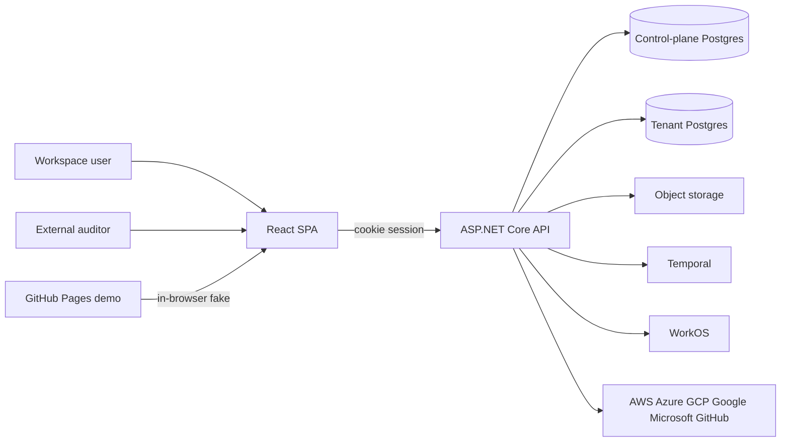
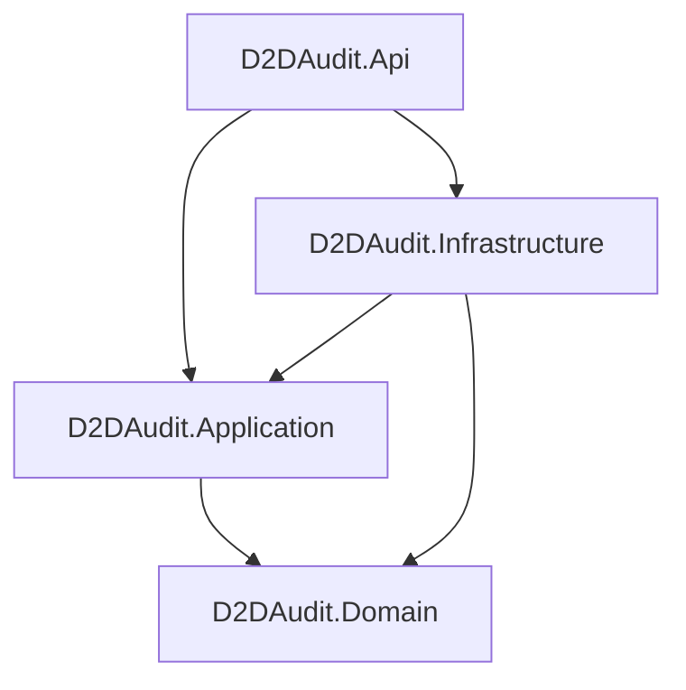
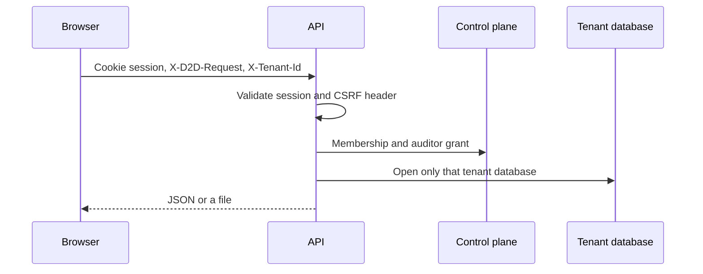

# Architecture

D2D Audit Services is a modular monolith. One API serves every tenant. Each tenant's business data lives in its own PostgreSQL database. The React app is the only UI. A public GitHub Pages build runs that same UI against an in-browser fake of the API.

## System context



Customers and auditors use the same web app. WorkOS asserts identity. The API resolves the tenant, then talks only to that tenant's database. Collectors read cloud and directory configuration. Evidence bytes go to object storage. Long collection runs on Temporal when it is configured, and in-process otherwise.

GitHub Pages is a static review build. It does not receive customer data. The demo installs a `fetch` shim that answers `/api` from example data.

## Gap program

The Nov 21, 2026 Harborline demo is tracked in [FEATURES.md](FEATURES.md). New modules land as their own pull requests and this section records them when they merge. Azure and GCP are `ICloudProvider` implementations next to AWS. A non-example workspace collects with an Azure app registration (Resource Manager and Microsoft Graph) or a GCP service account (Storage, KMS, Logging, and IAM). Harborline stays on the example fixture. New automated checks cover Azure storage, Key Vault, activity log, network rules, and Entra MFA, plus GCP buckets, KMS, audit sinks, and public IAM. The dashboard and framework pages show readiness from mapped controls that are passing. `GET /api/v1/reports/executive` is a one-page PDF of those percents. The incident register is `IIncidents`: employees report from `/me`, writers update status, root cause, and the linked control, and the IR-02 test "Incidents resolved within SLA" follows the register. The change log is `IChanges`. Writers record a change, approve it, or link a deploy. Sync pulls merged GitHub pull requests from a connected non-example installation, and Jira issues labeled `production-change` when `JIRA_BASE_URL`, `JIRA_EMAIL`, `JIRA_API_TOKEN`, and `JIRA_PROJECT` are set. The CM-11 test "production changes are reviewed" fails when a deployed change has no approval. Questionnaires are `IQuestionnaires`. Upload reads CSV or the first sheet of an XLSX. `IQuestionnaireAssistant` suggests an answer from policies, controls, and evidence. The current assistant is deterministic word overlap, not a model call. `ISystemDescription` stores one editable SOC 2 system description. The audit package writes it to `system-description.txt`, and drafts from the workspace when the row is empty. `IContinuity` stores the business impact analysis, continuity and disaster-recovery plans, and recovery exercises. The BC-01 test "Recovery exercises are recorded" fails when the log is empty or an exercise did not pass. `IVulnerabilityIngest` replaces AWS Inspector and GitHub Dependabot findings when those connections are live and not the example fixture. A failed call leaves the current rows. A pentest CSV upload stores the report and adds findings with source Pentest. Jira, Slack, Teams, and email automation actions are still the fake implementations.

## Layers and projects

Clean Architecture is enforced by NetArchTest in `D2DAudit.Tests`. Domain has no project references. Application does not reference Infrastructure or ASP.NET Core. Infrastructure does not reference the API. The API does not use Entity Framework directly.



| Project | Role |
| --- | --- |
| `src/api/src/D2DAudit.Domain` | Entities, enums, and pure rules. No I/O. |
| `src/api/src/D2DAudit.Application` | Use-case interfaces, request and response records, `Result<T>`. |
| `src/api/src/D2DAudit.Infrastructure` | EF Core, identity, storage, collectors, catalog, seed. |
| `src/api/src/D2DAudit.Api` | Composition root. Minimal API groups, cookies, CSRF, SignalR. |
| `src/api/tests/D2DAudit.UnitTests` | Domain and application rules. No database. |
| `src/api/tests/D2DAudit.Tests` | Architecture checks and HTTP tests on Postgres. |
| `src/web` | React, TypeScript, Vite. Features under `src/web/src/features`. |
| `src/aspire/D2DAudit.AppHost` | Local Postgres, MinIO, Temporal, API, and Vite. |
| `src/api/content/frameworks` | Framework JSON embedded in the API. |
| `src/seed` | Harborline example client. `brand.json` plus generated `client.json`. |
| `infra/terraform` | Placeholder for the AWS accounts. Nothing is applied. |

HTTP is one `MapGroup` per feature. Endpoints stay thin and call an application interface. Expected failures return `Result<T>` or a validator error. Exceptions are for bugs and for startup misconfiguration.

## Request flow



Mutating requests send `X-D2D-Request: 1`. The session cookie is `d2d_session` (Lax). The refresh cookie is Strict and limited to `/api/v1/auth`. `X-Tenant-Id` selects the workspace. Tenant resolution runs only on endpoints marked tenant-scoped, so the public trust page does not need a session.

Roles are Admin, Control owner, Editor, Viewer, Employee, and Auditor. Auditors are read-only on customer records. They can request samples, accept a sample, record a finding, and export a package, and only inside the frameworks on their grant.

## Multi-tenancy

A control-plane database holds tenants, users, memberships, auditor grants, and jobs. `DatabaseNames.ForTenant` derives a safe database name from the tenant id. The provisioner creates that database, migrates it, and loads framework content. Every business query uses a context opened for that database name. A user of one tenant cannot read another.

Retention is at least three years and can only grow. HIPAA tenants are expected to keep required documentation for at least six years. That floor is a product rule. The check constraint on the tenant row enforces the three-year minimum.

## Auth and WorkOS

`IIdentityProvider` is the boundary. Production and Staging require WorkOS. Development and Testing can use local identity, which signs tokens with a well-known development key and does not pretend to be Google, Microsoft, SSO, or MFA.

WorkOS is responsible for Google and Microsoft sign-in, enterprise SSO, directory sync, and email-password with an authenticator factor. The API validates the OIDC token. Users, roles, and auditor grants stay in the control plane. The login screen is the app's own UI.

## Background work and progress

```mermaid
flowchart LR
  call[API call]
  job[Job row]
  runner[In-process runner or Temporal]
  hub[SignalR /hubs/jobs]
  tray[Jobs tray]

  call --> job
  job --> runner
  runner --> hub
  hub --> tray
```

Collection uses Temporal when `TEMPORAL_ADDRESS` is set, and the same runner in-process when it is not. Production and Staging require Temporal. Tenant provisioning and the audit package record a job and advance real steps. The jobs hub pushes status to the signed-in tenant group. The tray shows queued, the current step, a percent when the step count is known, done, or failed with a reason. Progress is that state. It is not a timer painted on the client.

## Evidence

Each stored object is SHA-256 hashed with its metadata. The hash is linked to the previous chain head. Verify reads the objects back and does not change them. Automated checks write Parquet. Manual uploads store the original bytes. Object Lock is required in Production and Staging. Development uses a folder or MinIO through `IStorageProvider`.

The audit package zip includes the in-scope evidence files, a manifest, an integrity report for the whole chain, and the registers described in [FEATURES.md](FEATURES.md). When an auditor exports, evidence files are limited to the engagement's date range. Skipping a chain link would report a false break, so the integrity report still covers the full chain.

## Integrations

Collectors sit behind a small set of interfaces:

| Interface | What it does in this release |
| --- | --- |
| `ICloudProvider` | Read-only AWS account summary into a normalized resource. Azure and GCP fixtures ship with the example client. |
| `IWorkspaceDirectory` | Google Workspace and Microsoft 365 users. |
| `ISourceControlProvider` | GitHub repositories and branch protection. |
| `IIssueTracker` | Fake Jira issue id for automation rules. |
| `INotifier` | Fake Slack, Teams, and email delivery id. |

`AutomatedChecks` evaluates the normalized resources. A new framework does not add a collector. Framework content is JSON: clause numbers, short titles, and original summaries. Control mappings are many-to-many and may be partial.

## Demo mode

`VITE_DEMO=true` builds the Pages app. `installDemoFetch` replaces `window.fetch` for `/api`. `src/web/src/demo/backend.ts` routes the calls. `src/seed/client.json` and `src/web/src/demo/m6.ts` supply Harborline. Sign-in is local to the browser. Nothing is uploaded.

The fake keeps the same paths, roles, and error codes as the API so a screen that works in the demo works against the API.

## Deployment

The intended production host is AWS. App containers run on ECS Fargate. Dev, staging, and production are separate accounts. Cloudflare is the CDN and WAF. Tenant databases can be hosted on Neon or moved to a dedicated cluster. Object storage is S3 in production and Cloudflare R2 or MinIO in development. Terraform in `infra/terraform` is the place that definition will live. It is not applied yet.

GitHub Pages deploys `docs/` plus the demo build on every push to `main`. The workflow is `.github/workflows/pages.yml`.
