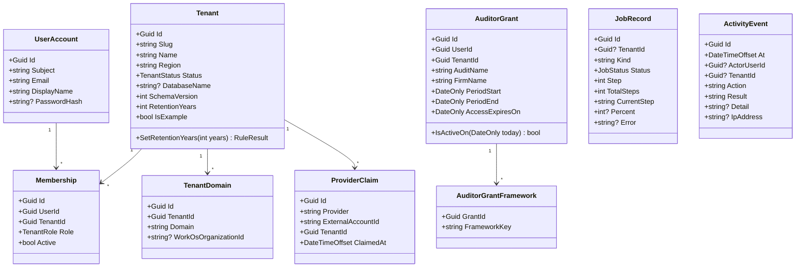
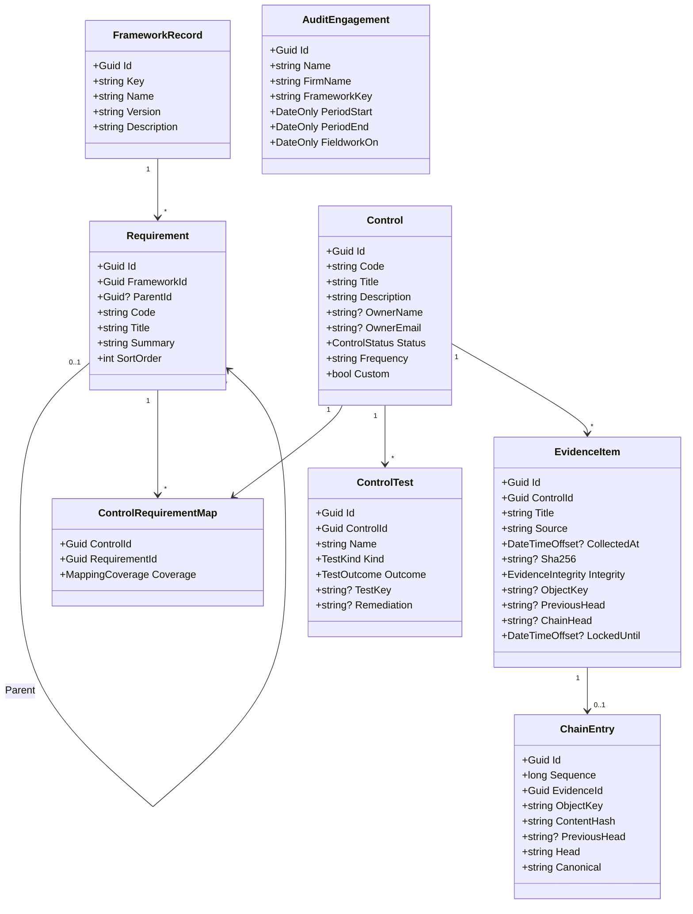
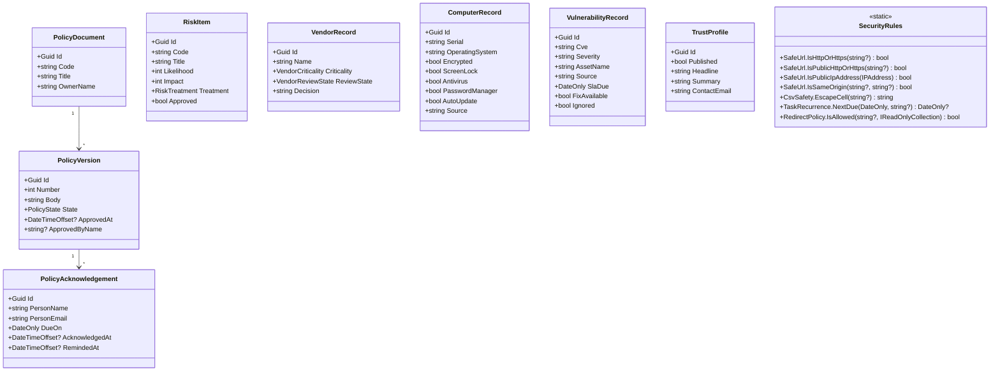
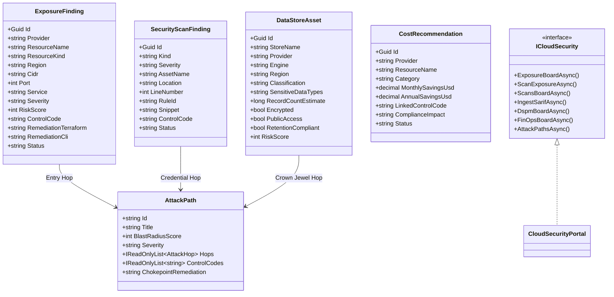
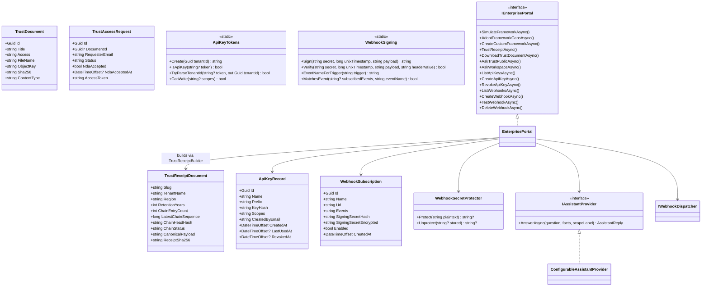

# Class Diagrams

Mermaid class diagrams of the D2D Audit Services domain model, application boundaries, and infrastructure adapters. Updated alongside every milestone.

## 1. Control-Plane & Multi-Tenancy Model (`D2DAudit.Domain`)

## 2. Core Compliance, Evidence Chain & Audit Model (`D2DAudit.Domain`)

## 3. Policies, Governance, Operations & Security Rules (`D2DAudit.Domain`)

## 4. Application Boundaries & Infrastructure Adapters

```mermaid
classDiagram
    class IIdentityProvider {
        <<interface>>
        +PasswordLoginAsync()
        +CompleteMfaAsync()
        +GetAuthorizationUrlAsync()
        +ValidateAccessTokenAsync()
    }
    class ICloudProvider {
        <<interface>>
        +string ProviderKey
        +ConnectAsync()
        +CollectAsync()
    }
    class IWorkspaceDirectory {
        <<interface>>
        +string ProviderKey
        +ConnectAsync()
        +CollectAsync()
    }
    class ISourceControlProvider {
        <<interface>>
        +string ProviderKey
        +ConnectAsync()
        +CollectAsync()
    }
    class IStorageProvider {
        <<interface>>
        +PutAsync()
        +GetAsync()
    }
    class IIssueTracker {
        <<interface>>
        +CreateIssueAsync()
    }
    class INotifier {
        <<interface>>
        +SendAsync()
    }
    class IAutomationDispatcher {
        <<interface>>
        +DispatchAsync()
        +DispatchForTenantAsync()
    }
    class IApiKeyAuthenticator {
        <<interface>>
        +ValidateAsync(token, cancellationToken) ApiKeyIdentity?
    }
    class IWebhookDispatcher {
        <<interface>>
        +DispatchAsync(databaseName, eventName, summary, detail, cancellationToken)
        +SendSingleAsync(webhook, eventName, summary, detail, cancellationToken) WebhookTestResultDto
    }

    IIdentityProvider <|.. WorkOsIdentityProvider
    IIdentityProvider <|.. LocalIdentityProvider
    ICloudProvider <|.. AwsCloudProvider
    ICloudProvider <|.. AzureCloudProvider
    ICloudProvider <|.. GcpCloudProvider
    IWorkspaceDirectory <|.. GoogleWorkspaceDirectory
    IWorkspaceDirectory <|.. Microsoft365Directory
    ISourceControlProvider <|.. GitHubSourceControl
    IStorageProvider <|.. S3StorageProvider
    IStorageProvider <|.. LocalStorageProvider
    IIssueTracker <|.. ConfigurableIssueTracker
    INotifier <|.. ConfigurableNotifier
    IAutomationDispatcher <|.. AutomationDispatcher
    IApiKeyAuthenticator <|.. ApiKeyAuthenticator
    IWebhookDispatcher <|.. WebhookDispatcher
```

## 5. Cloud Security Intelligence & Blast-Radius Graph (`D2DAudit.Domain` — M8)

## 6. Enterprise Compliance, Trust Center v2, Grounded AI & Developer API (`D2DAudit.Domain` — M9)

