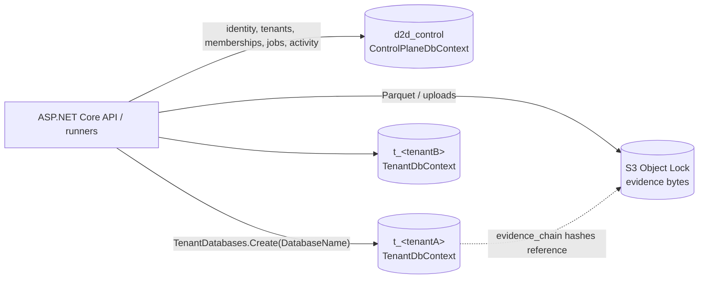
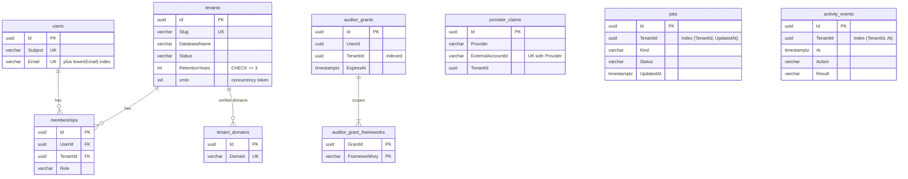
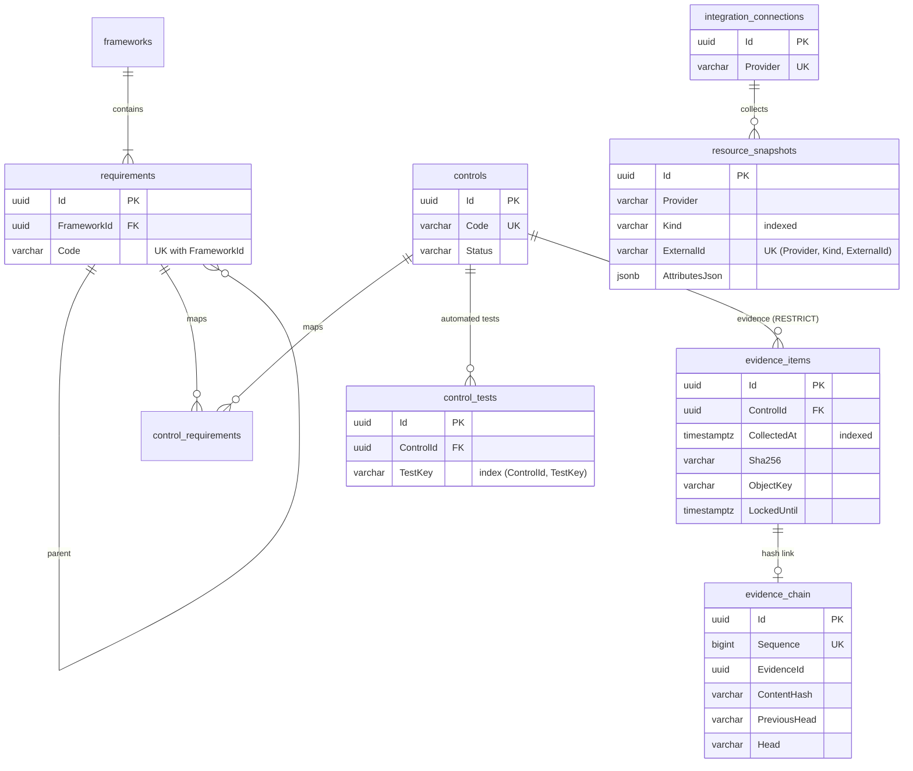
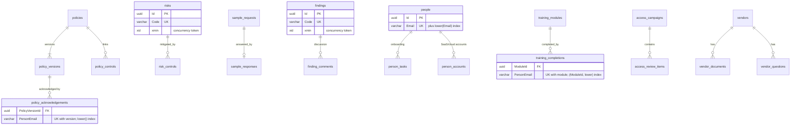
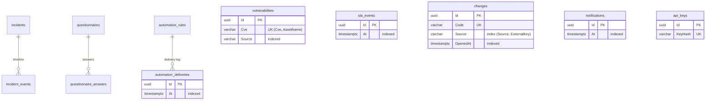

# Database Architecture

This document explains how D2D Audit Services stores data in PostgreSQL, why it is shaped that way, and what was reviewed and changed in the M11 database review. It complements [ARCHITECTURE.md](ARCHITECTURE.md) (system shape) and [CLASS_DIAGRAMS.md](CLASS_DIAGRAMS.md) (C# types).

- Engine: PostgreSQL 16 (Amazon RDS in production, `infra/terraform/rds_postgres.tf`; local portable or Testcontainers in development and tests).
- Access: EF Core 10 with Npgsql 10 (`src/api/src/D2DAudit.Infrastructure/Persistence`).
- Contexts: `ControlPlaneDbContext` (one shared database) and `TenantDbContext` (one database **per tenant**).

## 1. Overview



| Store | What lives there | Why |
|---|---|---|
| Control plane (`ConnectionStrings:ControlPlane`) | Tenants, users, memberships, auditor grants, tenant domains, provider claims, jobs, activity (security audit) log | Data that must be read **before** a tenant is known (login, tenant switch, auditor grants) or that spans tenants (job tray, provider claim uniqueness). |
| Tenant database (`t_<tenant-guid-N>`) | All customer business data: frameworks, controls, evidence metadata, evidence hash chain, policies, risks, people, vendors, vulnerabilities, incidents, … (~75 tables) | Hard isolation, per-tenant backup/restore/export/delete, per-tenant data residency, no `TenantId` predicate to forget. |
| Object storage | Evidence payloads (Parquet, original uploads), audit packages | Large immutable blobs; Object Lock (WORM) is mandatory in Production/Staging. The DB stores only keys + SHA-256 hashes. |

## 2. The two contexts and why

### Database-per-tenant, not row-level tenancy

The tenant boundary is the **database**, not a `TenantId` column:

1. `TenantProvisioner` derives the name with `DatabaseNames.ForTenant(id)` → `t_<guid N>`, validates it with `^[a-z][a-z0-9_]{0,62}$` (`DatabaseNames.IsSafe`), runs `CREATE DATABASE`, applies `TenantDbContext` migrations and loads framework content.
2. Every request resolves the active tenant (`X-Tenant-Id` + membership/auditor grant in the control plane) into `TenantContext`, and portals open `TenantDatabases.Create(tenant.DatabaseName)`. There is no code path that can query tenant tables without first choosing a database.
3. `StartupInitializer` migrates the control plane and then every tenant database on startup.

Consequences:

- **No global query filters are needed** in `TenantDbContext`: a forgotten `Where(TenantId == …)` cannot leak across tenants because the other tenant's rows are not in the database.
- **PostgreSQL Row-Level Security is not applicable** to tenant tables (there is nothing to filter on). The equivalent defence-in-depth control is a **per-tenant database role** (see §4).
- Control-plane tables *are* multi-tenant rows (`TenantId` columns). Every control-plane read that is tenant-scoped must lead with `TenantId` and must be backed by a `TenantId`-leading index (§6).

## 3. Entity-relationship diagrams

Columns are abbreviated to keys and the fields that drive queries. PK = primary key (all `uuid` unless noted), FK = foreign key, UK = unique.

### 3.1 Control plane



`auditor_grants`, `provider_claims` and `jobs` reference tenants/users by id without a declared FK (they are written by trusted code paths; see finding F-16).

### 3.2 Tenant: frameworks, controls, evidence



### 3.3 Tenant: governance (policies, risks, audits, people)



Also in this domain (no child tables): `audit_engagements`, `soa_entries`, `system_descriptions`, `organization_entities`, `privacy_assessments`, `ai_models`, `auditor_network`.

### 3.4 Tenant: operations and security



Also: `assets`, `computers`, `devices`, `work_tasks`, `check_weeks`, `vulnerability_policies`, `trust_profiles`, `trust_documents`, `trust_requests`, `webhooks`, `impact_analyses`, `continuity_plans`, `recovery_exercises`, `pentest_reports`, `exposure_findings`, `security_scan_findings`, `data_store_assets`, `cost_recommendations`, `phishing_campaigns`, `attack_surface_assets`, `remediation_pull_requests`. The authoritative list is `TenantDbContext.OnModelCreating` in `Persistence/DbContexts.cs`.

## 4. Tenancy model and isolation layers

| Layer | Mechanism | Where |
|---|---|---|
| 1. Authentication | Session cookie / API key → user | `Api/Security/ApiSecurity.cs` |
| 2. Tenant resolution | `X-Tenant-Id` must match an active membership or unexpired auditor grant | `TenantContext`, `ControlPlaneDirectory` |
| 3. Physical separation | One PostgreSQL database per tenant, name validated by regex before any connection | `DatabaseNames`, `TenantDatabases.Create` |
| 4. Scope inside a tenant | Auditor framework scope (`InScope`) and engagement window (`AuditWindow`) | `IntegrationQuery`, `AuditPortal` |
| 5. Object storage | Object keys prefixed with tenant id; downloads verify the prefix | `EvidenceWriter`, `IntegrationQuery.DownloadAsync` |
| 6. Integrity | Append-only `evidence_chain` + hash chain verification | §7 |
| 7. (Recommended) DB role per tenant | `CREATE ROLE t_<id>_app` with `CONNECT` only on its own DB; the API connects as that role via a pool keyed by tenant | F-12 |

**RLS:** not applicable to tenant databases. If a future feature introduces *shared* multi-tenant tables in the control plane (e.g. analytics roll-ups), enable RLS there with `ALTER TABLE … ENABLE ROW LEVEL SECURITY; CREATE POLICY tenant_isolation ON … USING ("TenantId" = current_setting('d2d.tenant_id')::uuid);` and set `d2d.tenant_id` per transaction.

## 5. Keys and ID strategy

- All primary keys are `uuid` generated in the application (no sequences, no DB round trip, ids are safe to expose).
- Today ids are `Guid.NewGuid()` (random v4). Random keys scatter inserts across the B-tree, causing page splits and poor cache locality on high-insert tables. **Recommendation (F-04):** use `Guid.CreateVersion7()` (time-ordered, RFC 9562) for new rows, starting with append-heavy tables (`evidence_items`, `evidence_chain`, `activity_events`, `jobs`, `resource_snapshots`, `sla_events`, `automation_deliveries`). It is a drop-in change (same `uuid` type, no migration). Never derive ordering semantics from the id; keep explicit timestamps.
- `evidence_chain.Sequence` (`bigint`, unique) is the logical ordering of the hash chain; the unique index makes concurrent appends from two API instances fail loudly rather than fork the chain.
- Natural keys are enforced with unique indexes (`controls.Code`, `risks.Code`, `(requirements.FrameworkId, Code)`, `(resource_snapshots.Provider, Kind, ExternalId)`, `api_keys.KeyHash`, …).

## 6. Indexing strategy

Rule: every `Where`/`OrderBy` in a list/read path is backed by an index whose leading column(s) match the predicate; control-plane indexes lead with `TenantId`. Tables in tenant DBs are small-to-medium per tenant, so we index for the actual access paths rather than speculatively.

| Index | Query it serves |
|---|---|
| `tenants (Slug)` UK | Public trust page lookup by slug, provisioning uniqueness |
| `users (Subject)` UK, `users (Email)` UK | OIDC subject lookup; email uniqueness |
| `ix_users_email_lower` (expr `lower("Email")`) **new** | Case-insensitive login/invite lookups (`IdentityProviders.PasswordLoginAsync`, `ProgramPortal` invites) |
| `memberships (UserId, TenantId)` UK, `memberships (TenantId)` | Tenant resolution per request; member list per tenant |
| `auditor_grants (UserId, TenantId)`, `auditor_grants (TenantId)` **new** | Auditor tenant resolution; auditor list per tenant (`ProgramPortal.AuditorsAsync`) |
| `jobs (TenantId, UpdatedAt)` **new, replaces `(TenantId)`** | Job tray: `WHERE TenantId = @t ORDER BY UpdatedAt DESC LIMIT 20` (`WorkspaceQuery`) |
| `activity_events (TenantId, At)` | Activity log per tenant ordered by time |
| `provider_claims (Provider, ExternalAccountId)` UK | Cross-tenant claim conflict check |
| `evidence_chain (Sequence)` UK | Chain append (max sequence) and ordered verification |
| `evidence_items (CollectedAt)` **new** | Recent evidence lists `ORDER BY CollectedAt DESC` (questionnaires, evidence page) |
| `evidence_items (ControlId)` (FK) | Evidence per control |
| `resource_snapshots (Provider, Kind, ExternalId)` UK, `(Kind)` **new** | Upsert during collection; `WHERE Kind = 'user'/'bucket'…` in governance and client portals |
| `vulnerabilities (Cve, AssetName)` UK, `(Source)` **new** | Ingest upsert; `WHERE Source = …` during feed reconciliation (`VulnerabilityIngest`) |
| `sla_events (At)` **new** | SLA timeline `ORDER BY At` (`OperationsPortal`) |
| `automation_deliveries (At)` **new** | Delivery log `ORDER BY At` (`OperationsPortal`) |
| `notifications (At)` **new** | Notification feed `ORDER BY At` (`ClientPortal`) |
| `changes (OpenedAt)` **new**, `(Source, ExternalKey)` | Change list ordering; webhook upsert by external key |
| `ix_people_email_lower` **new** | Person lookup by email (`ProgramPortal`, `GovernancePortal`) |
| `ix_policy_acknowledgements_email_lower` **new** | "My policies" lookup by email |
| `ix_training_completions_module_email_lower` **new** | Training completion lookup `(ModuleId, lower(PersonEmail))` |

Text search (`PeopleAsync`, `AssetsAsync`) uses `ILIKE '%term%'`, which cannot use a B-tree. Per-tenant row counts make a sequential scan acceptable today; if a tenant grows past ~50k people/assets add `pg_trgm` GIN indexes (`CREATE INDEX … USING gin ("Name" gin_trgm_ops)`).

## 7. Integrity

- **Hash chain.** `EvidenceWriter.AppendAsync` computes `ContentHash = SHA-256(payload)`, `Head = SHA-256(previousHead \n contentHash \n canonical)` and appends a `ChainEntry` with the next `Sequence`. Appends are serialised per tenant in-process (`SemaphoreSlim`); across instances the unique `Sequence` index rejects a forked append. `VerifyAsync` re-reads every object and recomputes the chain (read-only, `AsNoTracking`).
- **Append-only enforcement (new).** Triggers `evidence_chain_append_only` / `evidence_chain_no_truncate` (tenant DBs) and `activity_events_append_only` / `activity_events_no_truncate` (control plane) call `d2d_append_only()`, which rejects `UPDATE`, `DELETE` and `TRUNCATE`. A future retention purge job may delete (never update) by running `SET LOCAL d2d.allow_purge = 'on'` inside its transaction. SQL lives in `Persistence/Migrations/HardeningSql.cs`. `DROP DATABASE` (tenant offboarding) is unaffected.
- **Referential integrity.** Child rows cascade with their aggregate (policy → versions, vendor → documents, …). `evidence_items → controls` is now `RESTRICT`: deleting a control can never silently delete evidence (F-07).
- **Check constraints.** `tenants.RetentionYears >= 3`.
- **Unique constraints** guard natural keys and idempotent upserts (see §6). Tenant DBs need no `TenantId` in unique keys — uniqueness is per tenant by construction.
- **Column limits.** Every string has `HasMaxLength`, enums are stored as strings (`HasConversion<string>()` with max length 16–32) so values are readable and reorder-safe. `resource_snapshots.AttributesJson` is now `jsonb` (was `varchar(4000)`, which made collection fail for resources with large attribute sets — F-06).
- **Timestamps.** `DateTimeOffset` → `timestamptz` (UTC on the wire), `DateOnly` → `date`. Npgsql 6+ rejects non-UTC offsets, so no local-time values can be stored.

## 8. Concurrency

- **Optimistic concurrency (new):** `tenants`, `risks` and `findings` map PostgreSQL's system column `xmin` as a row version (`Property<uint>("Version").IsRowVersion()`). No column is added; EF adds `WHERE xmin = @original` to updates. A conflicting update raises `DbUpdateConcurrencyException`, which the API's exception handler maps to **409 Conflict** (`Api/Program.cs`). These are human-edited records where silent last-writer-wins would lose approvals or management responses. High-churn rows touched by background runners (`jobs`, `controls`, `control_tests`) deliberately do *not* use it.
- **Idempotent upserts** in collection rely on unique keys rather than locks.
- **No explicit transactions.** Each unit of work is a single `SaveChanges` (implicitly transactional), which is also what makes the retrying execution strategy safe (§9). Any future multi-`SaveChanges` workflow must wrap work in `db.Database.CreateExecutionStrategy().ExecuteAsync(...)`.

## 9. Performance and resiliency practices

| Practice | Status |
|---|---|
| Read paths use `AsNoTracking()` and project where practical | Applied broadly; `EvidenceWriter.VerifyAsync` fixed (F-09) |
| Split queries for multiple collection includes | `AsSplitQuery()` on control/evidence loads and `PeopleAsync` (F-10) |
| Deterministic paging (`OrderBy` + unique tiebreaker) and page-size caps (1–100) | People and assets lists now tie-break on `Id` (F-10) |
| Targeted single-row reads | `IntegrationQuery.DownloadAsync` now reads one evidence row + its control instead of every control and every evidence row (F-08) |
| Sargable equality | Exact email matches use `lower(col) = lower(@p)` backed by expression indexes instead of `ILIKE` (F-02) |
| LIKE escaping | Search terms escape `%`, `_`, `\` (`Persistence/DbText.cs`) (F-03) |
| Transient-fault retry | `EnableRetryOnFailure(Database:MaxRetryCount, default 3)` on both contexts (F-11) |
| Command timeout | `Database:CommandTimeoutSeconds` (default 30) on both contexts (F-11) |
| Connection pooling | Npgsql pool per connection string. Tenant pools are capped by `Database:TenantMaxPoolSize` (default 20) so N tenants cannot exhaust `max_connections` (F-12). Use RDS Proxy / PgBouncer (transaction mode) at > ~50 active tenants per instance. |

Configuration keys (all optional, clamped): `Database:CommandTimeoutSeconds` (1–600), `Database:MaxRetryCount` (0–10, 0 disables), `Database:TenantMaxPoolSize` (1–200). See `Persistence/DatabaseSettings.cs`.

## 10. Data lifecycle, retention and partitioning

| Table | Growth driver | Plan |
|---|---|---|
| `evidence_items`, `evidence_chain` | Every collection run / upload | Retained ≥ tenant `RetentionYears` (≥ 3, HIPAA 6). Never updated. Purge only rows whose `LockedUntil` has passed, oldest-first, via `d2d.allow_purge` — and re-anchor the chain by recording the purged head in a `chain_checkpoints` table before deleting (to be designed). |
| `activity_events` | Every security-relevant action, all tenants, one table | Highest-volume control-plane table. **Plan:** convert to `PARTITION BY RANGE ("At")` monthly partitions with `pg_partman`; detach + archive partitions older than retention to S3 (Parquet) instead of `DELETE`. Index `(TenantId, At)` is created per partition. |
| `resource_snapshots`, `control_tests` | Upserted per collection (not appended) | Bounded by the number of resources; no partitioning needed. |
| `sla_events`, `automation_deliveries`, `notifications` | Append per event | Keep 13 months online; nightly batch delete older rows (`DELETE … WHERE "At" < now() - interval '13 months'` in 5k batches). |
| `jobs` | One row per job | Delete finished jobs after 90 days. |
| Future high-volume tables (device check-ins, check results history, trend snapshots) | Per device / per run / per day | Design as time-series from day one: `(…, At)` composite index, monthly range partitions once a tenant DB exceeds ~10M rows, roll-ups for dashboards. |

## 11. Backup, disaster recovery and encryption

From `infra/terraform/rds_postgres.tf`:

- **Multi-AZ** RDS PostgreSQL 16 (synchronous standby, automatic failover).
- **Automated backups 35 days** → point-in-time recovery to any second in the window; `deletion_protection = true`; final snapshot on destroy.
- **Encryption at rest:** `storage_encrypted = true` with a customer-managed KMS key (data, backups, snapshots, replicas). Evidence payloads are additionally in an S3 Object Lock bucket (WORM, KMS).
- **Encryption in transit:** `rds.force_ssl = 1`; the API connection string uses `SSL Mode=VerifyFull` against the RDS CA.
- **Monitoring:** Performance Insights enabled; `log_connections` on.
- **Optional EU residency** replica/instance in `eu-central-1`.

Recommendations: enable `log_min_duration_statement = 500` and `pgaudit` for DDL/role changes (F-14); add a **read replica** for audit-package exports and analytics once primary CPU > 60% (F-15); test restore quarterly (restore a snapshot, run `/evidence/verify` for a sample tenant). Per-tenant restore is a `pg_dump -d t_<id>` / `pg_restore` of one database — a direct benefit of database-per-tenant.

## 12. Migrations workflow

- Two migration sets: `Persistence/Migrations/ControlPlane` and `Persistence/Migrations/Tenant`. Design-time factories read `CONTROL_PLANE_CONNECTION` / `TENANT_CONNECTION`.
- Add a migration:
  ```bash
  cd src/api/src/D2DAudit.Infrastructure
  dotnet ef migrations add <Name> --context TenantDbContext --output-dir Persistence/Migrations/Tenant
  dotnet ef migrations add <Name> --context ControlPlaneDbContext --output-dir Persistence/Migrations/ControlPlane
  ```
- Objects EF cannot model (triggers, expression indexes, `USING` casts) are added with `migrationBuilder.Sql(...)`; shared SQL lives in `HardeningSql.cs`.
- `SchemaParityTests` fails the build if a model change has no migration (`HasPendingModelChanges()`). Never hand-edit model snapshots.
- Startup applies migrations to the control plane and **every tenant database**. With many tenants this lengthens deploys and couples app start to DDL. **Recommendation (F-13):** move tenant migrations to a dedicated deploy step/job (`--migrate-only` mode) that fans out with bounded parallelism and records per-tenant schema version, and keep migrations backward compatible (expand → migrate → contract) so old and new app versions can run side by side.
- Use `CREATE INDEX CONCURRENTLY` (with `migrationBuilder.Sql(..., suppressTransaction: true)`) for indexes on large existing tables.

## 13. Scaling roadmap

1. **Now (≤ 50 tenants / instance):** single Multi-AZ instance, per-tenant pools capped at 20, retries + timeouts.
2. **Connection scale (50–500 tenants):** RDS Proxy or PgBouncer in transaction mode; reduce per-tenant pool to 5; move tenant migrations out of startup.
3. **Read scale:** read replica for exports, dashboards and Time Machine queries (`UseNpgsql` with a read-only connection for `AsNoTracking` report paths).
4. **Write/size scale:** shard tenant databases across several RDS instances — add `tenants.DatabaseHost` (or a server id) so `TenantDatabases` builds the connection string per tenant; residency already makes this natural (US / EU instances).
5. **Very large tenants:** dedicated instance per tenant; partition time-series tables.

## 14. Review findings (M11)

Severity: **High** = correctness/security or outage risk, **Medium** = performance or resilience risk at realistic scale, **Low** = hygiene.

| # | Finding | Severity | Status | Files |
|---|---|---|---|---|
| F-01 | Task assumption "row-level multi-tenancy with global query filters" does not match the code: tenancy is database-per-tenant; no filters are needed and RLS does not apply to tenant tables. Documented isolation layers instead. | Info | Documented | `Tenancy/TenantDatabases.cs`, §2/§4 |
| F-02 | Exact email matches used `ILIKE(col, value)`: `_`/`%` in an address act as wildcards (e.g. login as `a_b@x.com` could match `axb@x.com`), and the predicate cannot use the unique B-tree index. Replaced with `lower(col) = lower(@p)` and added expression indexes. | High | Fixed | `Identity/IdentityProviders.cs`, `Program/ProgramPortal.cs`, `Governance/GovernancePortal.cs`, `GovernanceHub/GovernanceHubPortal.cs`, migrations `M11DatabaseHardening` |
| F-03 | Search terms were interpolated into `ILIKE '%term%'` without escaping, so `%`/`_` matched everything. | Medium | Fixed | `Persistence/DbText.cs`, `GovernancePortal.PeopleAsync`, `ProgramPortal.AssetsAsync` |
| F-04 | Random v4 GUID primary keys fragment B-tree indexes on append-heavy tables. | Medium | Recommended (switch to `Guid.CreateVersion7()`; no migration) | all `Guid.NewGuid()` call sites |
| F-05 | Missing indexes for actual query patterns: jobs tray `(TenantId, UpdatedAt)`, auditor grants by tenant, evidence by `CollectedAt`, snapshots by `Kind`, vulnerabilities by `Source`, `sla_events.At`, `automation_deliveries.At`, `notifications.At`, `changes.OpenedAt`. | Medium | Fixed | `Persistence/DbContexts.cs`, migrations `M11DatabaseHardening` |
| F-06 | `resource_snapshots.AttributesJson` was `varchar(4000)`; large attribute sets fail the whole collection run, and JSON could not be queried/indexed. Converted to `jsonb` (`USING ::jsonb`). Add a GIN index only when a query filters inside the JSON. | High | Fixed | `DbContexts.cs`, tenant migration |
| F-07 | `evidence_items → controls` was `ON DELETE CASCADE`: deleting a control would silently destroy evidence metadata (and orphan chain entries). Now `RESTRICT`. | High | Fixed | `DbContexts.cs`, tenant migration |
| F-08 | `IntegrationQuery.DownloadAsync` loaded every control with all evidence and mappings to find one evidence row (O(all evidence) per download). Now a keyed lookup + one control. | Medium | Fixed | `Integrations/IntegrationQuery.cs` |
| F-09 | `EvidenceWriter.VerifyAsync` loaded the full chain with change tracking. | Low | Fixed (`AsNoTracking`) | `Evidence/EvidenceWriter.cs` |
| F-10 | `PeopleAsync` paged on non-unique `Name` with two collection `Include`s (cartesian explosion, unstable pages); assets paging also lacked a unique tiebreaker. | Medium | Fixed (`ThenBy(Id)`, `AsSplitQuery`) | `GovernancePortal.cs`, `ProgramPortal.cs` |
| F-11 | No `EnableRetryOnFailure` and no command timeout: RDS Multi-AZ failover (60–120 s) surfaced as 500s; runaway queries had no bound. | High | Fixed (configurable) | `Persistence/DatabaseSettings.cs`, `DependencyInjection.cs`, `Tenancy/TenantDatabases.cs` |
| F-12 | Each tenant DB has its own Npgsql pool (default max 100): 10 tenants × 100 × API instances can exceed `max_connections`. Capped per tenant (`Database:TenantMaxPoolSize`, default 20). Per-tenant DB roles and RDS Proxy/PgBouncer recommended. | High | Fixed (cap) / Recommended (proxy, per-tenant roles) | `DatabaseSettings.cs`, `TenantDatabases.cs` |
| F-13 | All tenant migrations run on app startup. | Medium | Recommended | `DependencyInjection.cs` (`StartupInitializer`) |
| F-14 | Audit-relevant tables (`evidence_chain`, `activity_events`) were append-only only by convention. Added DB triggers rejecting UPDATE/DELETE/TRUNCATE with a purge bypass. Also recommend `pgaudit` + slow-query logging on RDS. | High | Fixed (triggers) / Recommended (pgaudit) | `Persistence/Migrations/HardeningSql.cs`, both `M11DatabaseHardening` migrations, `infra/terraform/rds_postgres.tf` |
| F-15 | No read replica; exports and Time Machine compete with OLTP. | Low | Recommended | `infra/terraform/rds_postgres.tf` |
| F-16 | Control-plane `auditor_grants`, `jobs`, `provider_claims` have no FK to `tenants`/`users`; orphan rows possible if a tenant is deleted. | Low | Deferred (needs orphan cleanup before adding FKs) | `DbContexts.cs` |
| F-17 | No optimistic concurrency on human-edited records (last writer silently wins). Added `xmin` row versions on `tenants`, `risks`, `findings` and 409 mapping. | Medium | Fixed | `DbContexts.cs`, `Api/Program.cs` |
| F-18 | Several list endpoints return whole tables (resources, vulnerabilities, changes, computers, work tasks, evidence list, full chain for `ChainIntact`). Acceptable per tenant today; changing response shapes is an API contract change. | Medium | Recommended (cursor pagination `(At, Id)`, max 100; cache chain-intact result per head) | `IntegrationQuery.EvidenceAsync`, `ClientPortal`, `OperationsPortal`, `ProgramPortal` |
| F-19 | `activity_events` is a single unpartitioned table for all tenants. | Medium | Deferred (partition plan §10) | `DbContexts.cs` |
| F-20 | Evidence chain serialisation is in-process only; two API instances appending for the same tenant rely on the unique `Sequence` index (one request fails with a 500). | Low | Recommended (`pg_advisory_xact_lock(hashtext(tenant))` or retry on unique violation) | `Evidence/EvidenceWriter.cs` |

Tests added: `src/api/tests/D2DAudit.Tests/DatabaseHardeningTests.cs` — LIKE escaping, settings clamping/pool cap, append-only triggers on both databases, targeted and tenant-scoped evidence download, and case-insensitive-but-not-wildcard login.

## 15. Guidelines for new entities

Use this checklist when adding a table (new M11 feature branches will be conformed against it at integration):

1. **Which database?** Customer business data → `TenantDbContext` (no `TenantId` column; isolation is the database). Cross-tenant or pre-tenant data (identity, billing account, agent enrolment tokens before tenant is known) → `ControlPlaneDbContext` **with a `TenantId` column** and a `TenantId`-leading index for every tenant-scoped query.
2. **Keys:** `Guid Id` primary key, generated with `Guid.CreateVersion7()` for new code. Natural keys get a unique index (per tenant by construction in tenant DBs; `(TenantId, Key)` in the control plane).
3. **Strings:** always `HasMaxLength` (names 200, codes 32–64, emails 320, URLs 2048, free text 2000–4000). Use `text` only for genuinely unbounded content and validate size in the API.
4. **Enums:** `HasConversion<string>().HasMaxLength(32)`.
5. **Time:** `DateTimeOffset` (UTC) → `timestamptz`; `DateOnly` for calendar dates. Name event times `At`/`CreatedAt`/`UpdatedAt`.
6. **JSON:** `string` + `HasColumnType("jsonb")` (or owned `ToJson()`); add a GIN index only when a query filters inside the document.
7. **Indexes:** one for every `Where`/`OrderBy` in a list path; time-series tables get `(…, At)`; check your query with `EXPLAIN` on a seeded tenant.
8. **Relationships:** cascade only within an aggregate. Never cascade into evidence, chain, audit or activity tables — use `Restrict`.
9. **Reads:** `AsNoTracking()`, project to DTOs, `AsSplitQuery()` for multiple collection includes, deterministic `OrderBy(...).ThenBy(Id)`, page size clamped to 1–100.
10. **Writes:** one `SaveChanges` per unit of work; if you need several, wrap them in `CreateExecutionStrategy().ExecuteAsync`. Human-edited records that can be edited concurrently get `Property<uint>("Version").IsRowVersion()`.
11. **High-volume / append-only tables** (device check-ins, check results, trend snapshots, logs): plan retention up front (§10), add an append-only trigger via `HardeningSql.AppendOnly("table")` when the rows are audit evidence.
12. **Migration:** generate with `dotnet ef migrations add` for the right context; `SchemaParityTests` must pass; no snapshot hand-edits.

## 16. Unified M11 Schema Additions (`M11Unified`)

Following `M11DatabaseHardening`, all M11 feature domains were unified into one migration pair (`20261122004719_M11Unified` for `ControlPlaneDbContext` and `20261122004744_M11Unified` for `TenantDbContext`) verified by `SchemaParityTests` (`HasPendingModelChanges() == false`):

- **Control plane (`ControlPlaneDbContext`, +6 tables):** `signup_requests`, `member_invites`, `tenant_onboarding`, `tenant_subscriptions`, `tenant_security_settings`, `billing_events`.
- **Tenant database (`TenantDbContext`, +31 tables + `risks` quantification/acceptance columns):**
  - **Insights & Reporting (5):** `posture_snapshots`, `user_notifications`, `notification_receipts`, `notification_preferences`, `report_schedules`.
  - **Assurance, Custom Tests & Evidence Library (10):** `custom_test_definitions`, `test_suppressions`, `evidence_documents`, `evidence_document_links`, `evidence_requests`, `control_profiles`, `control_comments`, `control_comment_revisions`, `policy_attestation_campaigns`, `policy_attestations`.
  - **Employee Lifecycle & Vendor Risk (10):** `employee_groups`, `lifecycle_template_steps`, `lifecycle_settings`, `lifecycle_checklists`, `lifecycle_steps`, `vendor_profiles`, `vendor_discovery_suggestions`, `vendor_assessments`, `vendor_assessment_answers`, `vendor_review_documents`.
  - **Integration Marketplace (1):** `integration_sync_runs`.
  - **Device Agent & Security Academy (5):** `device_enrollment_tokens`, `device_credentials`, `device_posture_snapshots`, `academy_progress`, `academy_assignments`.
